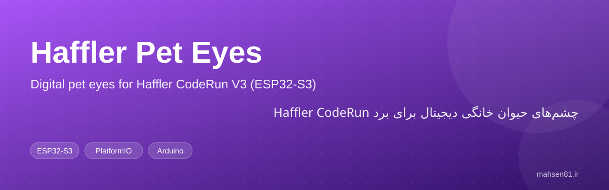

<!-- gen:header -->
<p align="center"></p>

<h1 align="center">Haffler Pet Eyes</h1>
<p align="center"><b>چشم‌های حیوان خانگی دیجیتال برای برد Haffler CodeRun</b><br><i>Digital pet eyes for Haffler CodeRun V3 (ESP32-S3)</i></p>
<p align="center">  </p>

<div dir="rtl">

## ✨ امکانات

- انیمیشن چشم با احساسات مختلف
- پنل کنترل
- ابزار عیب‌یابی سخت‌افزار

</div>

## 🚀 Quick start

```bash
Open pet_eyes/ in VS Code + PlatformIO → Upload
```

---

<p align="center">ساخته‌شده توسط <a href="https://mahsen81.ir"><b>محسن جباره‌اصل</b></a> — برنامه‌نویسی، طراحی سایت، ربات و هوش مصنوعی<br>
Built by <a href="https://mahsen81.ir">Mohsen Jabbareh-Asl</a> · ⭐ اگر مفید بود، ستاره بدهید · Need a custom version? <a href="https://mahsen81.ir">Get in touch</a></p>
